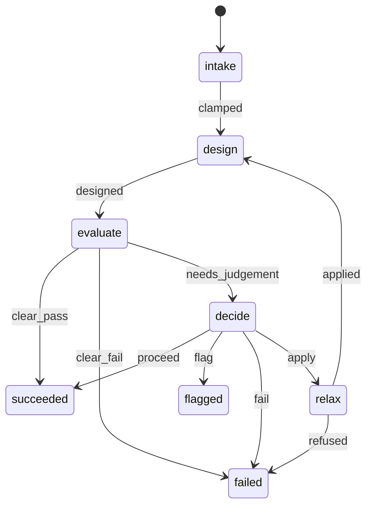

# mypibypy

Design **piFISH** split-probe primary probes (P1L / P1R) for genomic targets and
emit an order workbook that drops straight into an existing, validated
P2 / P3 / P4 amplifier pool.

## The piFISH cascade

```
target  ->  P1L + P1R (split primary)  ->  P2 (secondary)  ->  P3 (tertiary)  ->  P4 (Cy signal)
```

- `P1L = arm_left + revcomp(target_left25)`
- `P1R = revcomp(target_right25) + arm_right`
- Target footprint = **25 nt + 1 nt gap + 25 nt = 51 nt** (plus strand).
- The two constant arms meet at the 1-nt junction and together form the single
  landing site for P2's central anneal region — so P2 only lands when **both**
  primaries are bound (coincidence detection = specificity).
- P2 carries ~10 P3 sites; P3 carries ~10 P4 sites → ~100× signal per pair.

A **system** bundles one channel: the two arms + P2 + P3 + the fluorophore-labeled
P4. Designing a new target reuses these systems, so the **only new oligos are the
P1L/P1R primaries**.

## Configuring amplifier systems

**No real amplifier sequences are committed to this repository.** They are
lab-specific and frequently unpublished, so they load at runtime from a file you
keep outside version control. Resolution order:

1. `$MYPIBYPY_SYSTEMS` — explicit path to a systems JSON file
2. `systems.local.json` — in the working directory or any parent (gitignored)
3. `src/mypibypy/systems.example.json` — **synthetic placeholders**, so a fresh
   clone and the test suite work out of the box. They will not produce working
   probes.

To set up your own:

```bash
cp src/mypibypy/systems.example.json systems.local.json
# then replace the placeholder sequences with your real arms / P2 / P3 / P4
```

The example file documents the required architecture, which `crosshyb` and the
test suite both enforce:

```
arm_left  = [ top_L: 14 nt ][ mid_L: 8 nt ]
arm_right = [ mid_R: 8 nt ][ top_R: 14 nt ]
P2 anneal region (29 nt) = rc(top_R) + 1 nt + rc(top_L)
P2 repeat (30 nt) = spacer(10) + P3-binding(20)
P3 anneal (20 nt) = rc(P2's P3-binding region)
P3 repeat (30 nt) = spacer(10) + rc(P4)
mid_L / mid_R pair over 2–4 bp — the "pi bond" holding the pair together
```

Check `mypibypy.is_example()` before treating any output as orderable.

Order workbooks (`*.xlsx`) are gitignored for the same reason: they carry probe
sequences and target/fusion designs. Keep them in a local `designs/` directory.

## Setup

The design core is pure Python, but specificity screening shells out to BLAST
and bowtie, which are not pip-installable. Create the environment with conda:

```bash
conda create -n pifish-tools -c conda-forge -c bioconda \
    python=3.11 blast bowtie bowtie2 samtools viennarna openpyxl pytest
conda activate pifish-tools
pip install -e .          # from this directory
```

Then configure your amplifier systems (see below) and run the tests:

```bash
pytest                    # 512 tests, no PYTHONPATH needed
```

## Usage

```bash
# every locus in a loci file (see "Configuring target loci" below)
python -m mypibypy batch --loci loci.local.json -o order.xlsx

# one locus straight from the command line
python -m mypibypy design --build mm10 --region chr5:142906255-142906754 \
    --system cy5 --gene Actb --name promoter -o order.xlsx

# fusion junctions: sense + antisense pairs, gap placed on the breakpoint
python -m mypibypy fusion --loci loci.local.json -o fusion_order.xlsx

# with a genome screen (otherwise the workbook says no screen was run)
python -m mypibypy batch --loci loci.local.json -o order.xlsx \
    --bowtie-index /data/genomes/mm10
```

```python
from mypibypy.loci import load_loci
from mypibypy.pipeline import design_locus

for locus in load_loci("loci.local.json"):
    res = design_locus(locus)
    print(locus.gene, locus.name, res.pair.p1l, res.pair.p1r)
```

## Configuring target loci

Target loci are **inputs, not source**: which regions you probe is
experiment-specific, so they load from a JSON file rather than being hardcoded.
Resolution order is `--loci` → `$MYPIBYPY_LOCI` → `loci.local.json` (searched
upward, gitignored) → `loci.example.json` (the published mouse *Actb* positive
control, so a fresh clone runs).

```bash
cp src/mypibypy/loci.example.json loci.local.json   # then edit
```

Both `batch` and `design` print a warning, and write one into the workbook, when
example systems or example loci are in use -- those outputs are not orderable.

## Layout

| module           | role                                                            |
|------------------|-----------------------------------------------------------------|
| `sequence.py`    | UCSC sequence fetch, revcomp, GC, nearest-neighbor Tm, motifs    |
| `systems.py`     | amplifier-system registry (arms + P2/P3/P4 + fluorophore)        |
| `design.py`      | 51-nt window scan/scoring + P1L/P1R construction                 |
| `loci.py`        | target loci loaded from JSON (`Locus`, `load_loci`)              |
| `pipeline.py`    | locus → fetch → scan → chosen pair                               |
| `specificity.py` | pair-aware genome screening via local bowtie v1 / blastn         |
| `crosshyb.py`    | cross-hybridization against the amplifier pool and the order     |
| `thermo.py`      | buffer-aware Tm, wash-survival margins, mismatches priced by position, fraction bound |
| `expression.py`  | per-gene TPM for weighting off-target genes by abundance         |
| `accessibility.py` | RNA target-site secondary structure (RNAplfold)                |
| `fold.py`        | probe self-folding of P1L/P1R (RNAfold, DNA parameters)          |
| `outcomes.py`    | design → imaging-result record, for calibrating thresholds later |
| `agent/`         | the agent loop: closed actions, bounds, budgets, run record      |
| `ui.py`          | presentation helpers for the Streamlit app (testable apart from it) |
| `mcp_server.py`  | the pipeline as MCP tools for Claude Desktop / Claude Code       |
| `workbook.py`    | render the order workbook (ORDER_ssDNA / Parts list / per-locus) |
| `cli.py`         | `python -m mypibypy`                                             |

## QC and specificity

Window scoring balances GC (per-pad and matched between pads), matched Tm, and
rejects homopolymer / low-complexity runs. RepeatMasker overlap is reported.

### Pair-aware genome screening

A piFISH pair only makes a spot when **both** halves bind adjacent target, so a
genome hit for one half is not an off-target. `specificity.py` screens each half
separately and then joins the hits: a site is reported only where both halves
land on the same chromosome within the signal window (50 nt, see below), on the
same strand and in an order that could rebuild P2's landing site. A lone-half
hit lowers the score
rather than rejecting the pair. Each site is then passed through `thermo` to turn
"the aligner found it" into "it would still be bound after the washes".

Point it at a local database:

```bash
export MYPIBYPY_BOWTIE_INDEX=/data/genomes/mm10     # bowtie v1 index basename
export MYPIBYPY_BLAST_DB=/data/genomes/mm10         # or a makeblastdb basename
```

With neither set, the screen returns a `NOT_SCREENED` status with a reason, and
the workbook prints that verbatim. **A screen that did not run never renders as
a screen that passed** — check `SpecificityReport.screened` before making any
specificity claim.

Backends are measured, not assumed — rerun
`scripts/benchmark_specificity.py`, which plants sites with known mismatch
counts at known coordinates and counts recovery (40 × 25-nt queries per cell):

| backend | 0mm | 1mm | 2mm | 3mm | 4mm | hits kept |
|---|---|---|---|---|---|---|
| `bowtie -v 3 -a` | 40/40 | 40/40 | 40/40 | 40/40 | 0/40 | 160 |
| `blastn-short -word_size 5` | 40/40 | 40/40 | 40/40 | 40/40 | 18/40 | 1316 |
| `blastn-short -word_size 7` | 40/40 | 40/40 | 40/40 | 39/40 | 16/40 | 765 |
| `blastn-short -word_size 11` | 40/40 | 40/40 | 27/40 | 14/40 | 5/40 | 151 |
| `bowtie2 --very-sensitive-local` | 40/40 | 0/40 | 0/40 | 0/40 | 0/40 | 40 |

bowtie v1 is preferred: `-v 3 -a` is exhaustive within its budget and returns
only the planted sites. `bowtie2 --very-sensitive-local`, the obvious first
choice, is unusable at 25 nt — a single mismatch often leaves no seed — and is
kept only as a baseline. blastn needs `-dust no`, since DUST masks short queries
into silence, which looks exactly like a clean result.

### Mismatches priced by position, and fraction bound

Whether an off-target duplex survives the washes used to depend only on how many
mismatches it had, at a flat 8 °C each. Position and identity matter far more
than that: on a 25-mer, a terminal mismatch costs under 1 °C and a central one
5–6 °C. Both aligners report the off-target sequence (bowtie through SAM's `MD`
tag, BLAST through `sseq`), so each half-site is now priced by walking the actual
mismatched duplex with published nearest-neighbour parameters: internal
mismatches from Allawi & SantaLucia and Peyret *et al.*, terminal ones from
Bommarito *et al.* The tables come from Biopython rather than being retyped, and
the result matches Biopython's `Tm_NN` to 0.01 °C. Two mismatches at the ends of
a pad survive the washes; the same two in the middle melt. The count model could
not tell those apart.

The same dH/dS also give an **equilibrium fraction bound** for probe in excess,
θ = KC/(1+KC), at the limiting step:

- every `PairSite` carries `fraction_bound` (left × right), and the report
  carries `on_target_fraction` for the designed pair, so on-target and off-target
  sites sit on one continuous scale;
- `thermo_model` on each site says which model priced it. Duplexes the tables do
  not cover (adjacent mismatches, gapped BLAST hits, a missing `MD` tag) fall back
  to the count model, and say so, rather than being priced as perfect matches;
- the margins use the same Ct/4 convention as before, so at margin 0 a site is
  about 80% bound, not 50%. The washes carry no probe, so equilibrium there is a
  ranking device, not a kinetic model.

### Probe self-folding

`fold.py` folds each synthesized P1L and P1R with RNAfold using DNA parameters
(Mathews 2004) at primary-hyb salt. Formamide enters as an effective temperature,
as it does everywhere else. A primary whose pad folds onto itself cannot reach
its target, and one whose arm is tied up cannot present half of P2's site. The
report gives the mean **ensemble** pairing probability over the pad and over the
arm, with the MFE as context, and the pair takes the worse primary.

The ensemble is used rather than the MFE structure because the MFE misleads on
weak folds: one example primary's −2.2 kcal/mol MFE was 2% of the ensemble but
counted 60% of its pad as paired. The words next to the number are anchored to
background, because at 6× SSC random 47-mers are already a median 39% paired
(p90 48%). So "open" runs to 50% and "folded" starts at 65%. It is a reported
attribute, never a reject, it runs for DNA, RNA and fusion designs alike, and
without RNAfold it is `NOT_EVALUATED`.

## Fusion junctions

`mypibypy fusion` places the 1-nt gap **on the breakpoint**, so the left pad lies
wholly in the 5' partner and the right pad wholly in the 3' partner, and neither
parent gene alone can bring both halves together. `check_partner_specificity`
enforces that each pad is present in its own partner and absent from the other
(both strands). Sense and antisense pairs are emitted together, on two channels.

`design.arm_offsets` / `arm_separation` answer a question no per-probe check can:
where are the two constant arms actually anchored? A pair with its pads on the
other arms has the right lengths, the right arms and the right pads, and differs
only in that its arms sit at the footprint's outer ends rather than either side
of the gap. `--pad-assignment` chooses between the two, defaulting to `direct`
(arms beside the gap, as in the sense pair).

Both conventions give signal at the bench. An earlier version of this tool
claimed the outer-end geometry could not work, reasoning that arms 50 nt apart
could never present one 29-nt P2 site — that treated the arms as rigid rods when
they are flexible single-stranded tethers (22 nt is ~14 nm of contour against the
~17 nm spanned by 50 bp of duplex), and the lab's hand-made antisense pairs are
built that way and do produce signal. `arms_meet_at_junction` reports the
geometry only; it is not a verdict on whether a pair works, and the relative
efficiency of the two has never been measured.

That correction propagates into screening: if a *designed* pair bridges 50 nt,
an accidental one can too, so `specificity.DEFAULT_SIGNAL_GAP_NT` is 50 nt rather
than the 10 nt originally used. It is an observed lower bound, not a measured
limit.

## Screening a transcriptome: gene-level collapsing

A gene appears once in a genome and ~8.5 times in GENCODE. Screened against a
transcriptome without gene awareness, a probe finds its own target in every one
of its isoforms, the pair logic reads those as off-target sites, and a good probe
is rejected. Measured on real GENCODE v50 data, one footprint produced **70 raw
pair sites which collapsed to 1, and that single "off-target gene" was the
intended gene itself — verdict `fail`.** Naming the target gene excluded 140
on-target hits and the same probe passed.

```python
screen_pair(left25, right25, backend=transcriptome, target_gene="MYGENE")
```

- The gene is parsed out of the reference name (`gencode_gene`, field 6 of a
  pipe-delimited GENCODE header), and the parser is **detected from the names
  that actually came back**. A plain chromosome FASTA has no gene field, so
  `gene_aware` is `False` and a genome screen behaves exactly as before —
  guarded by `TestGenomeScreensAreUnchanged`.
- Site count and gene count are reported separately: 14 sites across 8 isoforms
  of 2 genes is 2 problems, not 14. Read `offtarget_genes`.
- Collapsing runs *after* the pair geometry, not before. The gap between the two
  halves decides whether a site can signal, and that gap belongs to one
  transcript's coordinates — two isoforms can place the same pads 1 nt apart in
  one and 800 nt apart in the other, because an exon is spliced out of only one.
  Collapsing first would have to pick a representative coordinate and would
  silently invent or destroy sites.

### Weighting off-target genes by expression

An off-target gene at 0.1 TPM and one at 500 TPM in the imaged cells are not the
same problem, but gene counting treats them alike. Supply a per-gene TPM table
measured in your cell type or tissue, and each off-target site's penalty is scaled
by `TPM / (TPM + 10)`:

```bash
python -m mypibypy rna --loci loci.local.json -o rna_order.xlsx \
    --transcriptome-index /path/to/gencode/transcripts --expression cells_tpm.tsv
```

```python
from mypibypy.expression import load_expression
screen_pair(left25, right25, backend=transcriptome, target_gene="MYGENE",
            expression=load_expression("cells_tpm.tsv"))
```

- Accepted layouts: a two-column gene/TPM table, any table with a gene column and
  a `TPM` column (RSEM `genes.results`), or salmon `quant.sf`, whose GENCODE
  transcript names are resolved to genes and summed. Versioned Ensembl IDs match
  across versions.
- **A gene missing from the table keeps its full penalty.** Absent is not the
  same as unexpressed: a filtered table, a renamed symbol and a version mismatch
  all look like a missing row.
- Low expression softens `fail` to `review`, **never to `pass`**, and only when
  every failing off-target gene is listed below 1 TPM. The table is an average
  over some population, not the cell being imaged.
- With no table, or on a genome screen (no gene names to match), weighting is
  `NOT EVALUATED` with a reason and the score is exactly what it was before.
  Nothing is fetched or defaulted: expression is specific to the cell type.
- `$MYPIBYPY_EXPRESSION` is used when `--expression` is not given, and by the MCP
  server. The curve and the 1-TPM floor are uncalibrated, and the caveat goes
  into the workbook with the number.

## RNA piFISH

RNA targets are identified by accession, not coordinates, because a transcript is
a molecule rather than an interval:

```bash
python -m mypibypy rna --loci loci.local.json -o rna_order.xlsx \
    --transcriptome-index /path/to/gencode/transcripts
```

`sequence.fetch_transcript` dispatches on the accession prefix — Ensembl REST for
`ENST`/`ENSMUST`, NCBI E-utilities for `NM_`/`NR_`/`XM_`/`XR_` — and validates
what comes back, because a truncated response that still parses as sequence would
silently shorten the transcript and shift every downstream offset:

- Ensembl is asked for JSON rather than FASTA, so a partial body fails to parse
  instead of becoming a short sequence. It needs an `Accept` header; sending
  `Content-Type` returns 200 with an empty body.
- RefSeq length is fetched independently via `esummary` and compared against the
  downloaded sequence, since efetch FASTA carries no length.

**Which reference an RNA design is screened against — transcriptome only, by
default.** The transcriptome is the population of molecules actually present, and
a footprint may legitimately span an exon-exon junction, which is often the point
since it is what makes a probe isoform-specific. Such a footprint does not map
contiguously to the genome at all: screened against one, its two halves land in
different exons thousands of nt apart, the real on-target site is invisible, and
the output is actively misleading. Genomic DNA is in the sample too, but a
standard RNA-FISH protocol has no denaturation step, so that DNA stays
double-stranded and a single-stranded probe cannot invade it. If your protocol
*does* denature, pass `--also-genome-index`. See `pipeline.RNA_SCREEN_POLICY`.

Note the co-localisation window is in **transcript** coordinates when screening a
transcriptome: two half-sites 50 nt apart in a spliced mRNA may be far apart in
the genome, and the spliced distance is the one that matters.

`exon_boundaries` on an RNA target are optional 0-based transcript offsets. They
are used only to *report* that a footprint spans a junction, and where —
`junction_position` distinguishes a boundary landing on the 1-nt gap, where each
pad lies wholly within one exon, from one landing mid-pad.

### Target-site accessibility

A probe can be perfectly specific and still never bind, because its site is
folded into a stem. This failure mode does not exist for DNA targets, which the
protocol denatures. `accessibility.py` scores the **target site on the
transcript** in the context of its flanks — not the folding of the probe oligo,
which is a different question.

The metric is the probability of an unpaired run long enough to nucleate
(default 8 nt), not the mean per-base unpaired probability. That choice is
measured, not stylistic — on a synthetic hairpin:

| region | P(base unpaired) | P(8-nt run unpaired) |
|---|---|---|
| open flank | 0.95 | 0.86 |
| stem | 0.28 | 0.046 |
| hairpin loop | 0.89 | **0.008** |

A mean would call that loop accessible; a probe cannot nucleate in it.

- The two pads are scored **separately** and the pair takes the **worse** of
  them, never the average — both halves must bind, so one buried pad kills the
  design however open the other is.
- Folded with `RNAplfold -W 80 -L 40` and 150 nt of flanking transcript either
  side. 150 is comfortably more than both `W` and `L`: every footprint base sees
  a full window, and nothing beyond `L` can pair with it at all. Where a site
  sits near a transcript end, the flank actually available is reported rather
  than padded over.
- It is a **ranking input and a reported attribute, never a hard reject**, and
  it does not override gross GC or Tm problems. Applied in the RNA path only, so
  `design._score` stays comparable with designs already ordered — installing
  ViennaRNA is the only thing that changes an ordering.
- **No calibrated threshold exists.** Nothing ties a piFISH failure to a measured
  accessibility, and the caveat travels with every number into the workbook.

Needs ViennaRNA (`conda install -c conda-forge -c bioconda viennarna`). Without
it, results are `NOT_EVALUATED` with a reason and contribute zero to ranking.

### Behind a TLS-inspecting proxy

If `curl` reaches these APIs but Python raises
`CERTIFICATE_VERIFY_FAILED`, the proxy's root is in the macOS keychain but not in
this interpreter's CA bundle. Export the system roots rather than disabling
verification:

```bash
security find-certificate -a -p /System/Library/Keychains/SystemRootCertificates.keychain > roots.pem
security find-certificate -a -p /Library/Keychains/System.keychain >> roots.pem
export SSL_CERT_FILE=$PWD/roots.pem
```

The error message says this too. The same applies to the UCSC fetch used by
genomic designs.

## Tiling: several pairs per target

`design.scan` always ranked many windows, but only the best became a pair. One
pair is defensible — at ~100x amplification per pair, and every validated design
in the lab is single-pair — so **tiling is headroom for marginal signal, not a
fix for a defect.** For scale: the pi-FISH paper used 35–50 probes per DNA locus
per channel, and for RNA roughly 10–15 pairs per transcript at medium-to-low
abundance, 1–5 for a highly abundant one.

```bash
python -m mypibypy batch --loci loci.local.json -o order.xlsx --pairs 6
python -m mypibypy rna   --loci loci.local.json -o rna.xlsx   --pairs 10 \
    --transcriptome-index /path/to/gencode/transcripts
```

- Selection is greedy over the existing ranking: walk candidates best-first and
  keep each that clears every chosen footprint by `--min-spacing` (default 3 nt)
  on top of not overlapping. Greedy rather than optimal on purpose — maximising
  the *count* of packed footprints would start preferring mediocre windows, and
  the reason to tile is more signal from good pairs.
- **Every selected pair is screened**, and for RNA has its accessibility
  evaluated, separately. Screening only the best and ordering ten would be worse
  than not tiling, since the unchecked nine look just as validated on the sheet.
  In a real run one of five tiled pairs came back with 17 off-target half-hits
  where the others had none.
- Asking for more pairs than fit returns what fits and warns, rather than
  failing.
- **Fusion junctions refuse `--pairs > 1`** rather than ignoring it. A junction
  is a single position — the design *is* the 1-nt gap on the breakpoint — and a
  second pair could only lie wholly inside one partner, where it reports that
  gene unfused, which is the one thing a fusion probe exists to rule out.
  (Sense and antisense are a separate axis and still both emitted.)
- Names gain a `_t01` suffix only when tiling. **A single-pair design is
  byte-identical to before tiling existed** — same names, same form-style locus
  sheet, same notes — verified by diffing a regenerated workbook against a
  pre-change snapshot, not assumed. A tiled locus sheet becomes a table with one
  row per pair, and the REUSED amplifier count does not grow with pair count,
  which is the whole point of tiling into an existing pool.

## The agent layer

Terms, in the lab's own framing: the **model** is stateless text in, text out;
the **harness** is the code around it — schema, state, routing, retries, calls
into deterministic tools; an **agent** is a harness where the model's output
decides the next step. The pipeline was built first and works without any of
this.

**The model is reserved for conflicts.** A deterministic classifier runs first
and sorts every evaluation into `CLEAR_PASS`, `CLEAR_FAIL`, or
`NEEDS_JUDGEMENT`; only the last consults a model. A lone-arm off-target hit
whose partner arm has nothing nearby cannot recruit P2 and so cannot make a
spot — that is geometry, already coded, and routing it through a language model
would add cost, latency and a chance of a confident wrong answer for no gain.
What genuinely needs judgement is: nothing passed and some constraint must give;
one arm matching several paralogous loci while its partner matches none; or
accessibility and specificity pointing in opposite directions.

Six things are load-bearing:

1. **The model never writes or edits a sequence.** No tool accepts one, its
   output schema has no field that could carry one, and an unexpected key is
   refused rather than ignored. Enforced by
   `tools.sequence_accepting_tools()` and tested structurally, not by prompt
   discipline.
2. **The action set is closed** — nine actions, enforced by structured output
   (`output_config.format`, a JSON-schema enum), not parsed out of prose.
3. **The model picks *which* constraint gives; the code decides *by how much*.**
   Step sizes live in `actions.STEPS`. The model supplies no numbers at all.
4. **Parameter bounds are code.** Out-of-range values are clamped and the clamp
   is recorded; an unknown system is refused outright, because there is no
   nearest valid channel and guessing orders the wrong dye.
5. **A durable run record.** Every tool call, clamp and decision, with the
   evidence it was made on, appended to a gitignored JSONL.
   `record.explain()` renders it as prose for the question "why this probe".
6. **Hard budgets.** Turns, model calls, tokens, and at most **three
   relaxations** — then the run reports failure rather than loosening until
   something passes, which is how a loop comes to "succeed" every time.

Degradation is a branch, not a crash: no model configured, a refusal, or an API
error all flag the run for human review rather than proceeding.
`stop_reason == "refusal"` is checked **before** the response content is read,
and server-side fallback is opted into — routine probe design sits close enough
to the biology classifier's territory that refusals must be handled normally.

### Which model

**A local model is the working path, not a fallback.** The lab's Anthropic
account is a Claude Enterprise seat, which covers chat and Claude Code but not
the API, and a managed user in a HIPAA-tier organisation cannot self-provision a
key — so there is no key to use. `AnthropicDecisionClient` remains for when one
appears; `OllamaDecisionClient` is what runs.

```bash
export MYPIBYPY_DECISION_CLIENT=ollama        # the default
export MYPIBYPY_LOCAL_MODEL=qwen3.5:9b
export MYPIBYPY_OLLAMA_HOST=http://127.0.0.1:11434
```

`build_client()` resolves the kind from argument → env → `ollama`, so swapping
to an API key or a different local model is configuration, not code.

### State machine and typed decisions

The order a run may take is a table, `agent/states.py`, and `DesignAgent.run`
drives it rather than holding the order in its `if` branches:



An event not in the table raises `IllegalTransition`; a relaxation past the
budget or a turn past `max_turns` raises `BudgetExceeded`, which the loop reports
as a failure. A hard budget (`exhausted`) can end the run from any live state.
Every transition is written to the run record (`kind: transition`).

What the model may say is `agent/models.py:DecisionModel` — closed keys, the
`Action` enum, a signal enum, and a bounded `reason` that is refused if it
contains an oligo-length run of bases. `Decision.from_payload` applies it to
every client; `test_models.py` pins it to the hand-written `ACTION_SCHEMA`.

**A PydanticAI client** (`MYPIBYPY_DECISION_CLIENT=pydantic_ai`, install with
`pip install -e ".[pydantic-ai]"`) sits behind the same `DecisionClient` seam. It
gets validate-and-retry for free, bounded by `max_attempts`, and never raises.
It reaches Ollama over `/v1`, where `think` is ignored but
`reasoning_effort: "none"` works. Measured on qwen3.5:9b, same evidence, same
decision: **~9 s against ~6.5 s** for the native client (twice the output
tokens), so the native client stays the default. The `num_ctx` cap does not
apply on `/v1`.

**`think: false` is mandatory, and measured.** qwen3.5 is a thinking model;
left alone it spends its budget reasoning instead of answering. On one identical
prompt, warm:

| | wall | eval tokens | thinking chars | usable |
|---|---|---|---|---|
| native, `think: false` | **4.6 s** | 96 | 0 | 5/5 |
| native, default | 22 s | 74 | 1455 | 3/3 |
| OpenAI `/v1`, `think: false` sent | 21.1 s | 74 | 1455 | — |
| OpenAI `/v1`, not sent | 21.3 s | 74 | 1455 | — |

A whole design takes 2–4 s, so a 22 s decision makes the agent useless. **`think`
is Ollama-native and the OpenAI-compatible endpoint ignores it silently** — the
last two rows are identical — which is the whole reason this client speaks to
`/api/chat` rather than `/v1`. There are tests for both facts.

Decoding is schema-constrained (`format` set to the action enum), temperature 0,
with the schema restated in the prompt as Ollama's guidance suggests. Every
response is validated and a malformed or empty one is retried up to three times.

**Prose never drives control flow.** In local-model trials the constrained
action was right while the sentence explaining it was backwards — it chose
`relax_gc` and then described *lowering* the upper GC limit, which is the
opposite of what `relax_gc` does. The enum is acted on; the reason string is
only ever displayed, labelled as the model's comment, and never parsed. Tests
assert that `apply_action` cannot even see it.

### Validation with the local model

| design | agrees | deterministic verdict | agent status | model calls | wall |
|---|---|---|---|---|---|
| genomic (hg38) | yes | pass | succeeded | 0 | 5.9 s |
| fusion #1 | yes | pass | succeeded | 0 | 0.9 s |
| fusion #2 | yes | review | flagged | 1 | 6.5 s |

Same footprint and primaries in all three, and the two `pass` designs still
consult no model at all. Agreement means the design matches **and** the status
is consistent with the deterministic verdict: flagging a `review` verdict for a
human counts as agreement; sailing past it with `proceed` does not.

Driven into the nothing-passes case (the lab's GC 0.40–0.60 / Tm 55–62 applied
as a filter, where 0 of 1692 windows survive), the loop followed the limiting
constraint each turn — `relax_tm` while Tm was limiting, then `relax_gc` once
the limiter flipped to GC — reaching 12 of 1692 windows, and then stopped itself
at `flag_for_review` after two of its three relaxations rather than loosening
further. 24 s, 3 model calls, every step in the run record.

### Validation against the verified designs

The check that matters is whether the loop reaches the *same* conclusions a
human already reached. `scripts/validate_agent.py` runs the verified designs
through it and compares:

| design | agrees | status | model calls | relaxations |
|---|---|---|---|---|
| genomic (hg38) | yes | succeeded | 0 | 0 |
| fusion #1 | yes | succeeded | 0 | 0 |
| fusion #2 | yes | succeeded | 1 | 0 |

Same footprint and same primaries in all three. Two needed no model at all;
the third consulted it because its deterministic screen verdict is `review`
rather than `pass`, which is a genuine judgement case being correctly routed.

That comparison earned its keep immediately. The first version of the agent
imposed a hard GC/Tm window by default and **disagreed with every verified
design** — at one real locus, zero of 1692 windows satisfy GC 0.40–0.60 and Tm
55–62, yet the locus has a working validated design, because `design._score`
penalises GC/Tm distance and never rejects on it. Hard windows are now opt-in
(`enforce_window`), so the default reproduces the verified path exactly and the
loop only relaxes a constraint someone actually imposed.

## The browser UI

```bash
cd mypibypy && streamlit run app.py
```

A form, a table and a download, in about 280 lines. Pick a target (region,
accession, or a fusion entry from your loci file), choose the channel, pair
count and spacing, run, read the candidates, download the workbook. The React
path was considered and declined: measured runtimes are ~2 s for a single-pair
hg38 design and ~4 s for six tiled pairs, so Streamlit's rerun model is fine and
there is no need for a job queue, progress streaming or async machinery.

- `st.cache_data` on the sequence and transcript fetches, `st.cache_resource` for
  the amplifier registry and the aligner handle. Caching is **memory-only** on
  purpose — `persist="disk"` would write real target sequence into Streamlit's
  cache directory.
- A missing screen renders as the words `NOT SCREENED`, and an unevaluated
  accessibility as `not evaluated`, never as a blank cell. A table is exactly
  where an absent result would otherwise read as a passing one.
- The workbook is rendered into memory and offered as a download; probe
  sequences are never written anywhere inside the repository.
- Tick **Run through the agent loop** to see the classifier's decision, the run
  record and why each step happened — including whether the model was consulted
  at all.
- The sidebar always names the `systems.local.json` actually in use, and says
  loudly when the synthetic examples are loaded.

The pure logic lives in `mypibypy/ui.py` so it can be tested without a browser;
the layout was verified by running the app.

### Chat

Switch **Interface** to *Chat* and talk to it:

> **design 3 pairs in cy5 for mm10 chr5:142906255-142906754**
> *Model comment (6.3s): Design parameters set for 3 pairs in cy5.*
> **Applied:** channel → cy5; pairs → 3
> 3 pair(s) designed against `mm10 chr5:142,906,255-142,906,754`.
> ⚠️ No specificity screen ran for 3 of 3 pair(s) …

> **too few passed, loosen the Tm**
> **Applied:** Tm window 55.0-62.0 → 53.5-63.5 C

The model does **exactly two things** in this path: turn a request into
parameters, and choose which constraint gives when nothing passes. The design,
the screens, the thermodynamics and the workbook are all deterministic.

**The target is never the model's.** It is pulled out of the user's own words by
`intent.extract_target`, a strict pattern in the harness — so a pasted run of
bases cannot become something the pipeline reads, and the intent schema has no
field for a region, an accession or a sequence at all. An intent carrying one is
*refused*, not ignored. This is the place the guarantee is most likely to erode
once a conversation is involved, so `tests/test_chat.py` attacks it directly.

Numbers arriving from chat go through the same `clamp` as numbers typed into the
form — less trustworthy, if anything. The model's sentence is shown as
*"Model comment"* and never interpreted. And when a relaxation is asked for while
the GC/Tm window is not being enforced, the reply says so, rather than reporting
a change that had no effect.

## Driving it from Claude (MCP server)

The agent layer has mypibypy call a model. The MCP server turns that around:
Claude Desktop or Claude Code calls mypibypy, as a set of tools, inside a
conversation that can also do other work. Both run on the same `pipeline`, so a
design is the same design whichever way it was asked for. And because it runs
under the Claude apps, it needs **no API key**; a Claude seat is enough.

```bash
pip install -e ".[mcp]"          # adds the `mcp` SDK; nothing else imports it
python -m mypibypy mcp           # stdio server; an MCP client launches this itself
```

| tool | does |
|---|---|
| `status` | which systems / loci files are loaded, whether they are placeholders, which screens are configured, where workbooks go |
| `list_targets` | every locus, fusion and RNA target in the loci file, with its id |
| `design_target` | design and screen one target by id; tiling, spacing and channel are parameters |
| `write_order` | write one order workbook for designs from this session; returns its path |

Under MCP the client decides what to call and in what order, so the agent's fixed
decision structure no longer applies. What each tool accepts and returns is the
whole safety story, and the rules for that are enforced in code:

- **No tool takes a sequence, a target or a path.** Targets are addressed by id
  from the loci file, so Claude cannot point the pipeline at a region,
  accession or file of its own. To design something new, add it to
  `loci.local.json`. `tests/test_mcp_server.py` checks this against the schemas
  the server actually advertises.
- **No tool returns a base.** Results carry pair names, coordinates, GC, Tm,
  QC flags and screen verdicts. The oligo sequences go only into the workbook,
  which the server names and saves under `designs/` (gitignored), so unpublished
  sequences are not sent to the model provider in a tool result.
- **Unscreened is said out loud.** Each pair reports `NOT SCREENED` with its
  reason, and placeholder systems or loci are flagged in every result.
- **Every design is recorded** in the agent run record (`agent_runs.local.jsonl`,
  model `mcp-client`), including clamped parameters and refusals.

Numbers go through the same `clamp` as the form and the chat. An unknown channel
is refused, and fusions refuse tiling for the reason given above.

**Registering it.** Use the conda env's Python, and put the env's `bin` on
`PATH` so bowtie, blastn and RNAplfold are found. MCP clients start servers with
a minimal environment. If the variables below are unset, the server uses
`systems.local.json`, `loci.local.json` and `designs/` from this directory.

Claude Code:

```bash
claude mcp add mypibypy --scope user \
  -e PATH="$HOME/miniforge3/envs/pifish-tools/bin:/usr/bin:/bin" \
  -e MYPIBYPY_BOWTIE_INDEX=/path/to/hg38 \
  -- "$HOME/miniforge3/envs/pifish-tools/bin/python" -m mypibypy mcp
```

Claude Desktop (`~/Library/Application Support/Claude/claude_desktop_config.json`):

```json
{
  "mcpServers": {
    "mypibypy": {
      "command": "/Users/YOU/miniforge3/envs/pifish-tools/bin/python",
      "args": ["-m", "mypibypy", "mcp"],
      "env": {
        "PATH": "/Users/YOU/miniforge3/envs/pifish-tools/bin:/usr/bin:/bin",
        "MYPIBYPY_BOWTIE_INDEX": "/path/to/hg38",
        "MYPIBYPY_TRANSCRIPTOME_INDEX": "/path/to/gencode/transcripts"
      }
    }
  }
}
```

| variable | default |
|---|---|
| `MYPIBYPY_SYSTEMS`, `MYPIBYPY_LOCI` | the `*.local.json` beside `pyproject.toml`, else the usual search |
| `MYPIBYPY_BOWTIE_INDEX` / `MYPIBYPY_BLAST_DB` | none: DNA designs are `NOT SCREENED` |
| `MYPIBYPY_TRANSCRIPTOME_INDEX` | none: RNA designs are `NOT SCREENED` (see `RNA_SCREEN_POLICY`) |
| `MYPIBYPY_EXPRESSION` | none: off-target genes are not weighted by abundance |
| `MYPIBYPY_MCP_OUT` | `designs/` beside `pyproject.toml` |
| `MYPIBYPY_AGENT_RUNS` | `agent_runs.local.jsonl` beside `pyproject.toml` |

Designs are held in memory, so `write_order` only knows designs made since the
server started.

## Recording what happened

`outcomes.py` keeps an append-only JSONL record linking each ordered pair
(sequences, locus, system, design-time QC, screen verdicts) to its imaging result
from [zFISHer](https://github.com/sstaller-sj/zFISHer), read from that project's
`reports/<layer>_puncta.csv`. It computes no score and fits no threshold: with
three designs there is nothing to fit, and this exists so the comparison becomes
possible later. Each record also stores the continuous numbers a later fit would
need: on-target and worst off-target fraction bound, whether expression
weighting ran, and the probe-folding MFE and pairing. The store holds real sequences, so it is gitignored
(`outcomes.local.jsonl`).

## Credit and license

Developed by Seth Staller, St. Jude Children's Research Hospital.

Released under the MIT License. Copyright is held by St. Jude Children's
Research Hospital; see LICENSE. To cite this software, see CITATION.cff.
